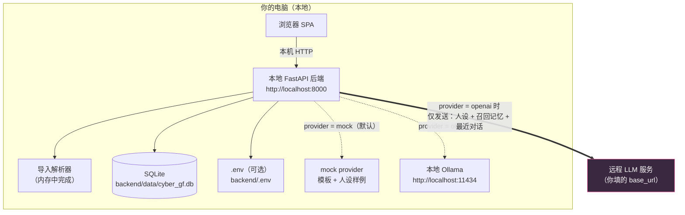

---
AIGC:
    Label: "1"
    ContentProducer: 001191440300708461136T1XGW3
    ProduceID: 4574a99947de89212c009903f0fa961d_5adb91f9cdf411f1a475525400248c00
    ReservedCode1: O+S9oFq5MgUjJzAWx0yBkYMQ3A138bB0l7/9NBEBZQ8lpqMCaDLy82+jipoAtcIV7MSmywSunU2vliafEFBQgdRfxnLK6+XomTwO0Fg8QA+8QZdWOw7PbQH0Fd1+pLR6f0DJARx1a/9JFgEwTo9bTwdEU99nX8vcW6QnystqJf1vdNZDW+5RZ1kb40g=
    ContentPropagator: 001191440300708461136T1XGW3
    PropagateID: 4574a99947de89212c009903f0fa961d_5adb91f9cdf411f1a475525400248c00
    ReservedCode2: O+S9oFq5MgUjJzAWx0yBkYMQ3A138bB0l7/9NBEBZQ8lpqMCaDLy82+jipoAtcIV7MSmywSunU2vliafEFBQgdRfxnLK6+XomTwO0Fg8QA+8QZdWOw7PbQH0Fd1+pLR6f0DJARx1a/9JFgEwTo9bTwdEU99nX8vcW6QnystqJf1vdNZDW+5RZ1kb40g=
---

# 隐私说明 · PRIVACY

赛博女友（cyber-girlfriend）是**本地优先**项目。本文件说明你的数据存在哪、会去哪、怎么删。

---

## 1. 一句话总结

- 默认（`mock`）和 `ollama` 模式下：**没有任何数据离开你的电脑**。
- 只有当你主动把 Provider 切到 `openai`（含任何远程兼容网关）时，**组装好的提示词**才会发送到你自己填的那个地址。
- 项目不含任何遥测、埋点、统计上报、自动更新检查。

---

## 2. 数据流向图

关键点：**导入的原始聊天记录永远不会被整体发送出去**。远程模式下发出的只是当轮生成的提示词，包含人设摘要、当轮召回的少量记忆（默认 5 条）与最近若干轮对话（默认 12 条）。

---

## 3. 数据存在哪里

| 数据 | 位置 | 备注 |
| --- | --- | --- |
| 人格、会话、消息 | `backend/data/cyber_gf.db` → `personas` / `chat_sessions` / `messages` | SQLite 单文件；人格表含角色卡扩展字段（`creator_notes` / `tags` / `extensions`） |
| 世界书条目 | 同上 → `worldbook_entries` | 关键词 + 注入文本，通常来自角色卡导入，**可能含作品设定细节** |
| 长期记忆 | 同上 → `memories` | 内容为自然语言短句 |
| 反馈样本（点赞/踩/改写） | 同上 → `feedbacks` | rewrite 存「原回复 → 你的期望回复」 |
| 导入的原始解析结果 | 同上 → `import_batches` | 含**已脱敏**的聊天消息 JSON 与脱敏统计，**仍属高敏感数据** |
| 运行期配置（含 API Key） | 同上 → `app_configs`（明文） | 优先于 `.env` |
| 代码级配置 / Key | `backend/.env`（可选，明文） | 需自行创建，`.gitignore` 已排除 |
| 临时上传文件 | 不落盘 | 聊天记录与角色卡均在内存中解析 |
| 你手动导出的备份 JSON | 你自己选择的位置 | 含全部业务数据与打码后的 Key，**请当作隐私文件保管** |
| 你手动导出的角色卡 PNG | 你自己选择的位置 | PNG 文本块（tEXt）内嵌整份角色卡 JSON，分享图片即分享设定 |

---

## 4. API Key 存储说明

- **存放位置**：`app_configs` 表（设置页保存）或 `backend/.env`（`CG_LLM_API_KEY=`）；两者均为**明文**。
- **接口返回一律打码**：`GET /api/settings` 返回 `llm_api_key_masked`（形如 `sk-1****abcd`）与 `llm_api_key_set`（布尔），不返回明文。
- **保存规则**：设置页提交时，若字段为空**表示不修改**；若回传的是带 `*` 的掩码值，同样视为不修改。
- **建议**：不要截图分享设置页；不要把 `.env`、`backend/data/` 提交到 Git（`.gitignore` 已覆盖）；如需更高安全性，请改用 `ollama` 本地模型（完全不外发）。
- **日志**：后端日志只记录 provider 名称与数据库路径，不打印 Key 与聊天正文。

---

## 5. 聊天记录（含导入数据）删除指引

| 想删的东西 | 操作 |
| --- | --- |
| 单个会话及其消息 | 聊天页会话列表点 🗑；或 `DELETE /api/sessions/{id}` |
| 某个人格及其全部关联数据 | 调用 `DELETE /api/personas/{id}`（级联删除该人格的会话、消息、记忆、反馈样本**与世界书条目**，响应返回各类删除条数） |
| 单条世界书条目 | 世界书面板点删除；或 `DELETE /api/worldbook/{id}` |
| 单条记忆 | 记忆库列表点「删除」，或聊天页右侧记忆侧栏点 🗑；或 `DELETE /api/memories/{id}` |
| 导入的原始批次数据 | 导入接口提供 `DELETE /api/import/batches/{id}`（前端删除向导文件后即可调用） |
| 自己导出的备份 / 角色卡文件 | 备份 JSON 与角色卡 PNG 都在你选择的位置，直接删除文件即可（服务端无副本） |
| 全部数据（一键清空） | 停止服务后删除 `backend/data/cyber_gf.db`，重启后自动重建空库并写入示例人格 |
| 已发给远程模型的内容 | **无法撤回**，请在使用远程 Provider 前自行评估 |

> 删除人格时会一并清理其会话、消息、记忆、反馈样本与世界书条目；导入批次（`import_batches`）需单独删除。

---

## 6. 数据脱敏：内置能力 + 自行处理

### 6.1 内置自动脱敏（默认开启）

导入链路（`/api/import/upload` 与 `/api/cards/import`）在**落库前**会自动调用 `services/importer/desensitize.py`，命中即替换为占位符，并把统计写入 `import_batches.desensitize_stats`：

| 类型 | 处理方式 |
| --- | --- |
| 手机号 / 身份证号（含校验位）/ 邮箱 / 银行卡号 / URL / IPv4 / QQ 号 | 匹配后替换为对应占位符，原文不落库 |
| 黑名单关键词（`desensitize_blacklist`） | 命中的**整条消息被丢弃**，仅计数不保存 |
| 开关与范围 | 设置页可关闭（`desensitize_enabled`）；关闭后脱敏与黑名单**同时失效**（统计中如实标注 `enabled=false`） |

注意边界：

- 脱敏是**正则规则**实现，只覆盖结构化标识，**无法识别姓名、住址、公司名、第三方昵称等非结构化隐私**；
- 脱敏只在导入时执行，**不可逆**，且不会回溯处理已入库的历史数据；
- 已有关闭脱敏或关闭后才导入的数据，仍需按下节手动清理。

### 6.2 仍建议自己做的处理

- 真实姓名 → 统一昵称（同一人替换为同一昵称，否则发言人统计会分裂）
- 家庭住址、公司全称、门牌号 → `[地址]`
- 聊天中出现的第三方隐私内容建议整段删除
- 若只想快速体验，可直接使用内置示例人格，无需导入任何真实记录

---

## 7. 备份与角色卡导出的隐私边界

- **全量备份 JSON**（`GET /api/backup/export`）：包含人格、世界书、会话、全部消息、记忆、反馈样本，等于**一份完整可读的隐私副本**；`settings.llm_api_key` 已打码（另给 `llm_api_key_set` 布尔值），**不含明文密钥**。请勿把备份文件放进公开仓库、网盘共享目录或聊天窗口。
- **备份导入**（`POST /api/backup/import`）：默认 `import_api_key=false`，不会把备份里的打码串写回配置；`dry_run=true` 可先试算不落库。导入后的数据会与本机现有数据合并，注意 `strategy` 选择（`merge_by_id` / `merge_by_name` / `skip_duplicates`）。
- **角色卡导出**：`GET /api/personas/{id}/card.json|png` 只导出**人格设定与世界书**，**不含聊天记录、记忆、反馈**。但 PNG 格式会把角色卡 JSON（base64）写入 PNG 文本块（`tEXt`，keyword 为 `chara` / `ccv3`），因此**分享这张图等于分享你的角色设定**（含 `creator_notes` 等你写的备注）。
- **角色卡导入**：卡片内文本字段同样过内置脱敏；卡片自带的 `extensions` 等未知字段原样保存在 `personas.extensions`，若卡片来自不可信来源，请先检查其内容再导入。

---

## 8. 网络行为清单

| 场景 | 是否有网络请求 | 目标 |
| --- | --- | --- |
| 打开前端页面 | 否 | 全部资源本地（含 `vendor/vue.global.prod.js`） |
| 导入 / 解析聊天记录 | 否 | 本机后端 |
| 角色卡导入 / 导出（JSON、PNG） | 否 | 本机后端，PNG 解析与生成均在本机完成 |
| 世界书匹配 / 命中测试 | 否 | 本机 `services/lore/matcher.py` |
| 全量备份导出 / 导入 | 否 | 本机后端，文件由浏览器下载或上传 |
| 聊天（mock） | 否 | 本地模板生成 |
| 聊天（ollama） | 本机回环 | `http://localhost:11434`（默认） |
| 聊天（openai 兼容） | 是 | 你在设置页填写的 `llm_base_url` |
| 记忆反思（LLM 抽取） | 仅 openai 模式 | 同上 |
| 记忆反思（mock） | 否 | 本地启发式规则 |
| 启动 / 运行 | 否 | 无遥测、无更新检查 |

---

## 9. 免责声明

- 本项目仅供**个人学习、研究与技术交流**使用。
- 导入他人聊天记录、模仿他人说话风格可能涉及**他人隐私与人格权**，请确保你拥有相应数据的合法使用权，并自行承担由此产生的一切法律责任。
- 严禁将本项目用于冒充真实人物进行诈骗、骚扰、深度伪造或其他违法用途。
- AI 生成内容不构成任何专业建议（医疗、法律、心理等）。
- 数据丢失、密钥泄露、第三方服务条款违规等风险由使用者自行承担；请自行做好备份与访问控制（不要将服务暴露到公网，本项目默认仅监听本机）。
*（内容由AI生成，仅供参考）*
*（内容由AI生成，仅供参考）*
